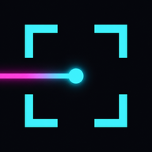
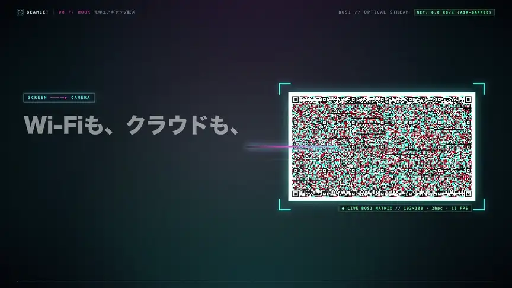

# Beamlet



**An optical-stream transfer tool that hands encrypted files from one device to another using nothing but a screen and a camera.**  
Move multiple files (up to 100 MB in total) between two devices right in front of you — no Wi-Fi, mobile data, Bluetooth, cloud, or USB.

<br clear="left">

<video src="artifacts/promo/final-promo.mp4" poster="artifacts/promo/previews/final/15_cta_36.2s.jpg" controls playsinline width="100%">
  <a href="artifacts/promo/final-promo.mp4">
    
  </a>
</video>

> Full HD video with audio (MP4, 9.4 MiB): [artifacts/promo/final-promo.mp4](artifacts/promo/final-promo.mp4)

## How it works (BOS1: Beamlet Optical Stream v1)

1. **Single-use public-key QR and confirmation code** — The receiver creates a fresh X25519 key pair every time and shows its public key and receive capabilities once as an ordinary QR code. The sender reads it with its camera, and both screens show a 6-digit confirmation code to compare
2. **End-to-end authenticated encryption** — HKDF-SHA256 + ChaCha20-Poly1305 encrypts not only the file contents but also the manifest (file names, MIME types, sizes, thumbnails). A third party recording the sender's screen cannot decrypt it
3. **Multi-level color modulation with automatic color correction** — Each cell carries 1–3 bits (black and white / 4 colors / 8 colors), and palette bands at the top and bottom of the frame plus a least-squares fit track the screen's color temperature and uneven lighting
4. **Horizontal-band tiles and a fountain code** — Within a frame, data is protected by Reed-Solomon + CRC32 tiles laid out in horizontal bands, so when a rolling shutter mixes different frames into the top and bottom of one capture, the intact tiles are still recovered. Across frames, RaptorQ (RFC 6330) fills the gaps, so recovery completes even with dropped frames or when capture starts midway
5. **Early preview and mixed-in stable frames** — The manifest and thumbnails are delivered first, so a preview appears before the full contents arrive. The "compact" mode for phones rotates the frame 90° to fill a portrait screen and mixes in black-and-white "stable" frames, so transfers complete even with cameras that struggle to tell colors apart

## Layout

| Path | Contents |
|---|---|
| [`beamlet-stream/`](beamlet-stream) | Rust crate implementing the BOS1 layout, rendering, camera-side detection, RaptorQ, and encryption |
| [`beamlet-stream/wasm/`](beamlet-stream/wasm) | WebAssembly exports for the browser (C ABI, no JS dependencies) |
| [`web/`](web/README.md) | Offline-capable PWA with send (`send.html`), receive (`receive.html`), and benchmark (`lab.html`) pages |
| [`tools/bos-lab/`](tools/bos-lab/README.md) | Offline measurement CLI for frame generation, a synthetic camera, and analysis of recorded video |
| [`docs/STREAM_FORMAT.md`](docs/STREAM_FORMAT.md) | Specification of the BOS1 optical stream format |
| [`artifacts/promo/`](artifacts/promo/README.md) | Promotional video, storyboard, and its full production source |

## Quick start

### Run the Web / PWA version

```sh
./web/build.sh                                      # build the wasm into web/pkg/beamlet.wasm
python3 -m http.server 8765 --bind 127.0.0.1 -d web # open http://127.0.0.1:8765/
```

Using the camera (`getUserMedia`) from another device such as a phone requires serving over HTTPS. See [`web/README.md`](web/README.md) for the steps and detailed usage.

### Tests and measurement tools

```sh
cargo test --workspace   # verify the Rust crates and the synthetic camera pipeline
node web/test/e2e.mjs    # end-to-end check of the wasm API (key QR → send → receive and verify)
```

See [`tools/bos-lab/README.md`](tools/bos-lab/README.md) for how to capture and analyze with a real camera.
