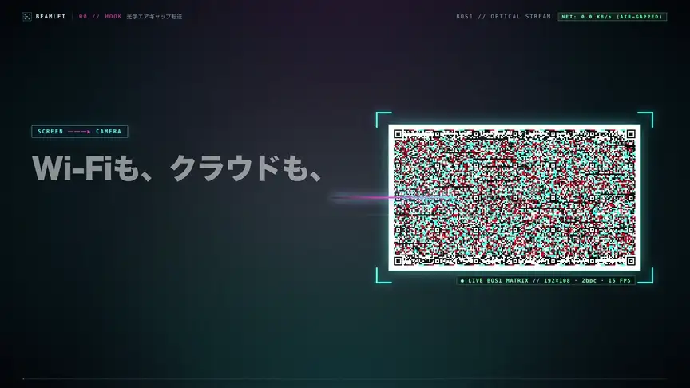

# Beamlet promotional video (`artifacts/promo/`)

The promotional video for Beamlet (an optical-stream Web / PWA app that transfers encrypted files between devices using only a screen and a camera), together with everything used to produce it.

<video src="final-promo.mp4" poster="previews/final/15_cta_36.2s.jpg" controls playsinline width="100%">
  <a href="final-promo.mp4">
    
  </a>
</video>

> Full HD video with audio (MP4, 9.3 MiB, about 81% smaller than the 49.2 MiB master): [final-promo.mp4](final-promo.mp4)

## Contents

| Path | Contents |
|---|---|
| `final-promo.mp4` | Compressed promotional video (1920×1080 Full HD / 30fps / H.264 High `yuv420p` Rec.709 `bt709` + AAC 48kHz stereo / 38.0 s / 9.3 MiB) |
| `previews/promo-preview.webp` | Lightweight animated WebP for inline autoplay in the GitHub README (864×486 / 10fps / 4.9 MiB) |
| `storyboard.md` | Art direction and the storyboard for all 7 scenes |
| `source/` | Full production source (Remotion 4 / React / TypeScript + frame generation from the real `beamlet.wasm` + real-UI capture with Playwright + audio synthesis and compression with Python/FFmpeg) |
| `assets/` | Real `BOS1` frames, public-key QR, real-UI screenshots, generated backdrop and sample photo (with `.recipe.yaml`), and the mastered soundtrack used in the video |
| `previews/` | Representative frames, contact sheet, and transition check for the final cut (`final/`), plus `ffprobe.json` / `diagnostics.txt` |

## Regenerating

### Prerequisites
- Node.js 22+ / npm
- Python 3.10+ (`numpy`, `playwright`)
- FFmpeg / FFprobe (with `libx264`, `libwebp_anim`, `aac`)
- Google Chrome or Remotion Headless Shell

### Steps

```sh
cd artifacts/promo/source
npm install

# 1. Generate BOS1 optical frames and the public-key QR from the real beamlet.wasm, and synthesize the music and sound effects
npm run assets

# 2. Capture real UI screenshots of web/ with Playwright
npm run capture-ui

# 3A. Render with the Remotion CLI (normal environments)
npm run render

# 3B. Deterministic Full HD render through the piped renderer (for network-isolated / sandboxed environments)
npm run render:pipe

# 4. Compress for embedding in the repository and README (generates the MP4 and the animated WebP)
npm run compress

# 5. Verify the output video (ffprobe, black-frame detection, audio peak analysis, 16 representative frames and a contact sheet)
npm run verify
```
